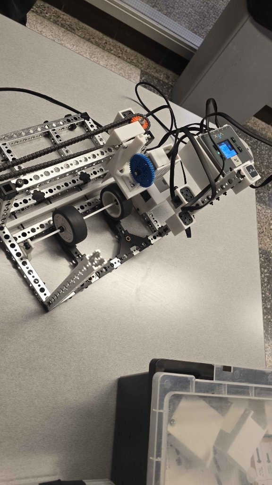
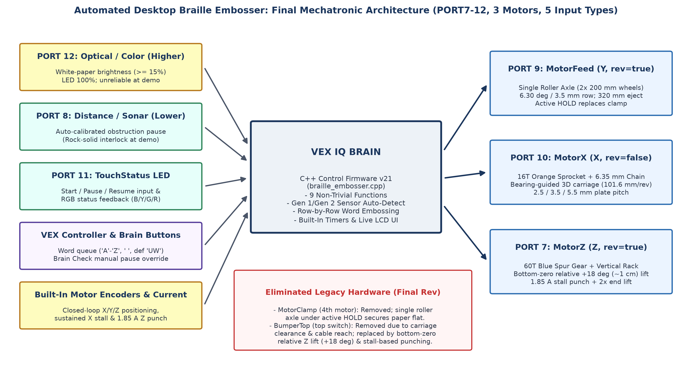

# Automated Desktop Braille Embosser

An open-source, low-cost desktop Grade 1 Braille embosser built with VEX IQ electronics, a Pitsco Tetrix Prime aluminum gantry frame, and custom 3D-printed mechanical interfaces.

Developed at the University of Waterloo by Liam McCarthy, Junwon Will Choi, Nicholas Chan, and Joseph Lu.



## Overview

Commercial desktop Braille embossers typically cost 2,000 to 5,000 CAD. This prototype uses a single-pin 3-axis Cartesian architecture to emboss user-queued words onto standard paper sheets over a rigid 3D-printed female die base plate (`BrailleBasePlate`):

- **Row-by-Row Horizontal Sweep**: Pre-decodes the queued word (`A`-`Z` and spaces, up to 15 characters) and sweeps monotonically left-to-right across Row 0, Row 1, and Row 2 to eliminate chain reversal backlash between dots.
- **3-Motor Architecture**: Uses a single Y-axis dual-wheel roller axle under active `hold` braking (no separate mechanical clamp motor) and bottom-zero relative Z actuation (no top bumper switch).
- **Safety Interlocks & Clean Shutdown**: Polls an auto-calibrated distance sensor, optical/color paper sensor, and Touch LED before every dot slot, with non-abort clean shutdown (`2x` final stylus lift, full `320 mm` sheet ejection, motor coast).

## Repository Layout

```text
braille-embosser/
|-- firmware/
|   |-- braille_embosser.cpp          # VEXcode IQ C++ control firmware (v21, Allman style)
|   `-- Braille_Embosser.iqcpp        # Ready-to-open VEXcode IQ 4.68.1 project file
|-- cad/
|   |-- CanNewAssymbly/               # Final SolidWorks gantry, carriage, rack, roller & base plate CAD
|   |-- archive/                      # Earlier design iterations (1010 extrusion, early Tetrix base)
|   `-- README.md                     # CAD inventory and print notes
|-- docs/
|   |-- architecture.md               # Firmware modules, kinematics, and state machine reference
|   `-- media/                        # Build photos, Concept 1 sketch, and engineering diagrams
|-- LICENSE
`-- README.md
```

## Hardware & Wiring Map (VEX IQ Brain)

| Brain Port | Identifier | Polarity | Hardware Subsystem |
| :--- | :--- | :--- | :--- |
| `PORT7` | `MotorZ` | `reversed = true` | Z-axis 60T blue spur gear + 3D-printed vertical rack stylus |
| `PORT8` | `DistanceBed` | N/A | Lower right-upright obstruction sensor (Gen 1 sonar / Gen 2 distance auto-detected) |
| `PORT9` | `MotorFeed` | `reversed = true` | Single Y-axis roller axle (2x 200 mm VEX IQ travel wheels, `200.0 mm/rev`) |
| `PORT10` | `MotorX` | `reversed = false` | X-axis 16T orange sprocket + 6.35 mm pitch VEX chain (`101.6 mm/rev`) + ball-bearing carriage |
| `PORT11` | `TouchStatus` | N/A | Front Start / Pause / Resume Touch LED (Blue / Yellow / Green / Red) |
| `PORT12` | `OpticalPaper` | N/A | Upper right-upright white-paper sensor (Gen 1 color / Gen 2 optical auto-detected) |
| Wireless | `Controller` | N/A | VEX IQ Remote Controller (`EUp`/`EDown` cycle, `FUp` append, `FDown` start) |



## Kinematics & Base Plate Geometry

- **Base Plate (`BrailleBasePlate`)**: `2.5 mm` diameter cavities spaced `2.5 mm` from the left plate edge, `3.5 mm` intra-cell horizontal spacing (`12.40 deg`), `5.5 mm` inter-cell gap (`9.0 mm` / `31.89 deg` total character pitch), and `3.5 mm` vertical row step (`6.30 deg` on the `200 mm` roller).
- **Bottom-Zero Relative Z Stroke**: Start with the stylus resting at the bottom (`0 deg`). Homing lifts strictly `+18.0 deg` (`~1 cm`) before X moves. Each dot drives down at `100%` torque until physical stall (`1.85 A` or `160 ms` zero velocity), applies a `150 ms` bottom squeeze and `250 ms` hold dwell, lifts strictly `bottomPos + 18.0 deg`, and pauses `450 ms` at the top. Shutdown raises Z `2x` (`+36.0 deg`) before ejecting `320 mm` at `50%` speed.

## Quick Start

1. Open [firmware/Braille_Embosser.iqcpp](firmware/Braille_Embosser.iqcpp) in **VEXcode IQ** (4.68.1 or newer) and download to the VEX IQ Brain.
2. Position the Z-axis stylus all the way at the **bottom** and slide a sheet of paper across the base plate under the Y-axis roller wheels.
3. Run the program:
   - Startup lifts Z `~1 cm`, homes X to the motor-side end stop, auto-detects Gen 1/Gen 2 sensors on `PORT1`-`PORT12`, and displays `v21 C:P__G__ D:P__G__`.
   - Use Brain Left/Right (or Controller `EUp`/`EDown`) to cycle `'A'`-`'Z'` and `' '`, Brain Check (or `FUp`) to append, and tap **Touch LED** (or `FDown`) to start (defaults to `"UW"` if empty).
   - Tap **Touch LED** mid-job to pause/resume; Brain **Check** overrides a sensor pause if needed.

## Known Limitations & Lessons Learned

- **Base Plate Revision Alignment**: Before final demonstration, the original calibrated 3D-printed base plate fractured and a rushed replacement print was pulled from an older CAD file with slightly offset hole spacing, causing physical stylus-to-hole misalignment during embossing. Verify cavity dimensions (`2.5 / 3.5 / 5.5 mm`) in `cad/CanNewAssymbly/BrailleBasePlate.SLDPRT` before slicing and keep a labeled spare printed.
- **Optical / Color Paper Sensor Mounting**: While the lower `DistanceBed` obstruction interlock operated reliably ("rock solid"), the elevated side-mounted `OpticalPaper` bracket sat too far and at too oblique an angle from the paper surface to read reflected brightness consistently. Future builds should mount the optical/color sensor perpendicularly within `10-15 mm` directly over the paper path.

## License

Released under the [MIT License](LICENSE). Third-party Pitsco Tetrix Prime and VEX IQ STEP/SLDPRT library models remain the property of their respective manufacturers.
