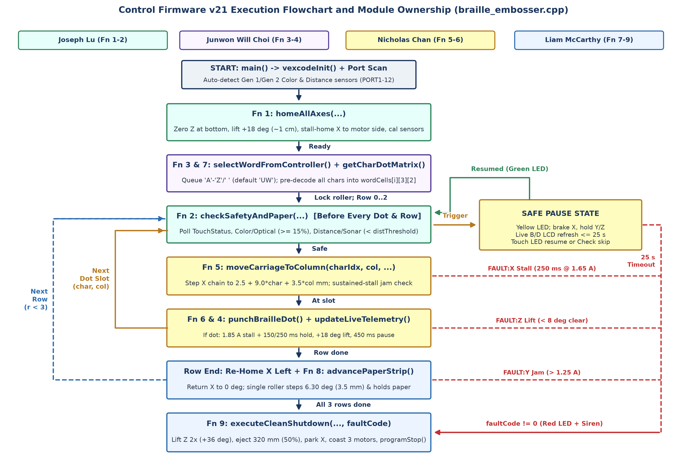

# Firmware Architecture (v21)

The control firmware in [../firmware/braille_embosser.cpp](../firmware/braille_embosser.cpp) (synced with [../firmware/Braille_Embosser.iqcpp](../firmware/Braille_Embosser.iqcpp)) uses explicit non-blocking `while` loops with timers, encoders, velocity/current stall monitoring, and zero mutable global variables.

## Module Breakdown

1. **Homing, Calibration & Safety (`homeAllAxes`, `checkSafetyAndPaper`, `readPaperBrightness`, `readBedDistance`)**
   - Scans `PORT1`-`PORT12` at startup via `vexDeviceTypeGetByIndex()` to bind Gen 1 (`colorsensor` / `sonar`) or Gen 2 (`optical` / `distance`) drivers automatically.
   - Zeroes Z at bottom, lifts strictly `+18.0 deg` (`~1 cm`) before X moves, homes X to the motor-side stop using `180 ms` continuous stall confirmation (`30%` speed, `1.40 A`), and releases chain preload with `stop(coast)`.
   - Polls `TouchStatus`, `OpticalPaper`, and `DistanceBed` before every dot slot and inter-row step; enters a 25-second yellow pause state refreshing live `B`/`D` values every `200 ms`, resuming on safe Touch LED tap or `Brain.buttonCheck` manual override.
2. **User Interface & Telemetry (`selectWordFromController`, `updateLiveTelemetry`)**
   - Cycles `'A'`-`'Z'` and `' '` via Brain or Controller buttons (`TouchStatus` or `FDown` starts; defaults to `"UW"`).
   - Refreshes the 3-line Brain LCD (`<= 16` chars/line) with active row, character, punched dots, live brightness/distance readings, and elapsed time.
3. **X-Axis Chain Carriage & Z-Axis Stall Punch (`moveCarriageToColumn`, `punchBrailleDot`)**
   - Indexes `(charIdx, dotCol)` at `COL_ZERO_DEG + charIdx * CHAR_PITCH_DEG + dotCol * INTRA_COL_DEG` (`charIdx < 0` re-homes cleanly to `0 deg`) with `8.0 deg` anti-backlash approach and `250 ms` sustained jam detection (`1.65 A`).
   - Drives Z downward at `35%` speed and `100%` torque until stall (`1.85 A` or `160 ms` zero velocity), applies a `150 ms` bottom squeeze + `250 ms` hold dwell, lifts strictly `bottomPos + 18.0 deg`, and pauses `450 ms` at the top.
4. **Braille Lookup, Single-Roller Feed & Shutdown (`getCharDotMatrix`, `advancePaperStrip`, `executeCleanShutdown`)**
   - Pre-decodes all letters from `const bool BRAILLE_ALPHABET[26][3][2]` into `wordCells[16][3][2]`.
   - Advances the single `200 mm` dual-wheel axle (`PORT9`) by `6.30 deg` (`3.5 mm`) per row at `18%` speed with active `hold`, and ejects `576.0 deg` (`320 mm`) at `50%` speed on normal completion after lifting Z `2x` (`+36 deg`).
